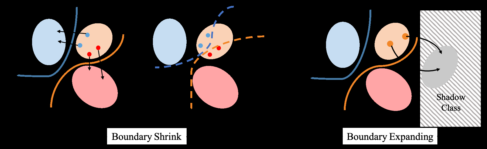
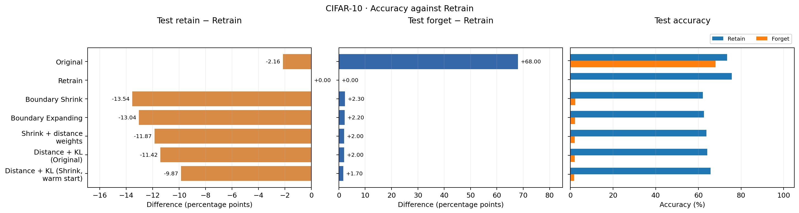
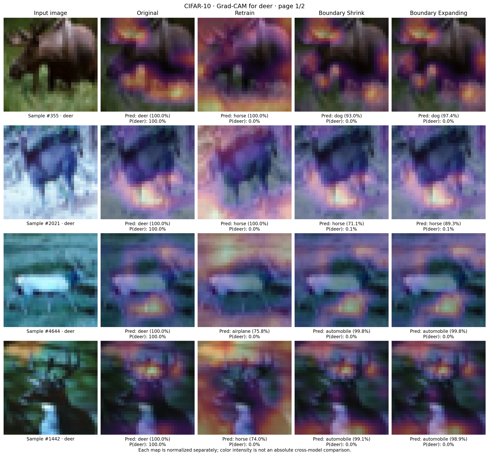
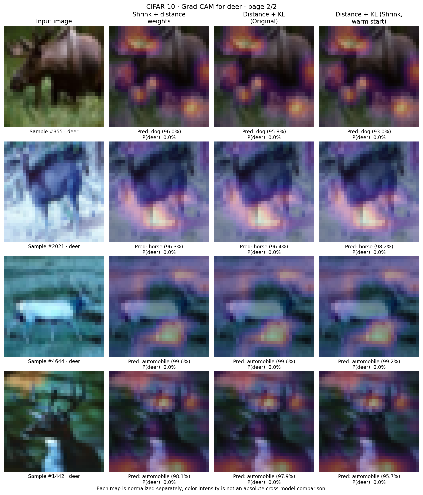
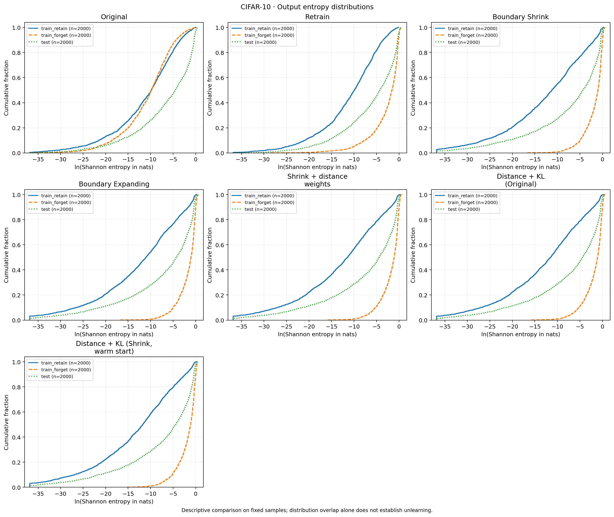
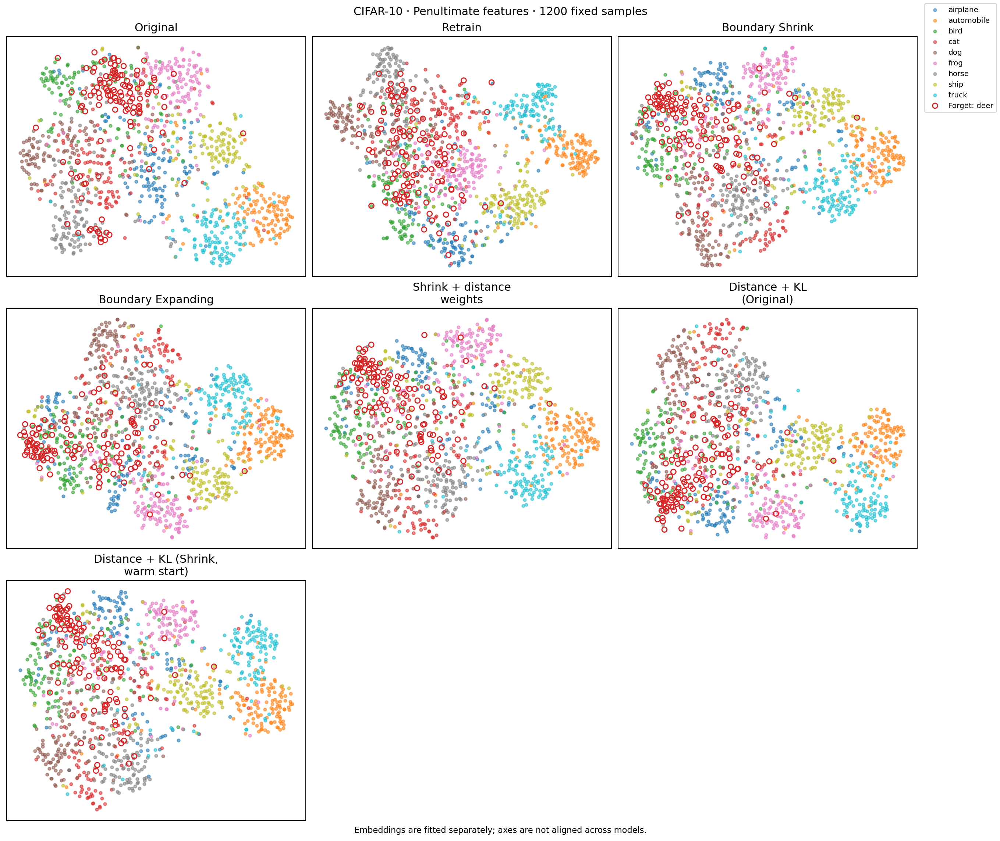

# Đánh giá Boundary Unlearning trên CIFAR-10 và CIFAR-100

> Bản đọc Markdown đồng bộ từ `../main_1.tex`. Bản LaTeX là nguồn chính; PDF là bản để kiểm tra trình bày.

## Tóm tắt

Machine Unlearning hướng đến loại bỏ ảnh hưởng của dữ liệu được chỉ định khỏi mô hình đã học với chi phí thấp hơn huấn luyện lại từ đầu. Báo cáo đánh giá Boundary Shrink và Boundary Expanding trong bài toán quên toàn bộ một lớp trên CIFAR-10 và CIFAR-100, dùng Original và Retrain làm đối chứng. Trên CIFAR-10, hai phương pháp đạt độ chính xác kiểm thử lớp quên lần lượt 2.30% và 2.20%, nhưng độ chính xác các lớp giữ lại thấp hơn Retrain 13.54 và 13.04 điểm phần trăm. Trên CIFAR-100, cả hai đạt độ chính xác kiểm thử lớp quên 0%, đồng thời giảm khoảng 8.9 điểm trên các lớp giữ lại. Riêng CIFAR-10, chúng tôi khảo sát ba biến thể kết hợp tìm ngưỡng vượt biên, trọng số mẫu và chưng cất tri thức. Biến thể warm start đạt 65.74% trên các lớp giữ lại và 1.70% trên lớp quên, tăng 3.67 điểm so với Shrink với tổng thời gian khoảng 227 giây, so với 399 giây của Retrain. Các kết quả cho thấy đánh đổi giữa độ chính xác và chi phí trong cấu hình khảo sát; một seed, một lớp quên mỗi dataset và việc chưa đánh giá trực tiếp tấn công suy luận thành viên giới hạn mức độ khái quát của kết luận.

## Giới thiệu

Xóa dữ liệu khỏi kho lưu trữ không tự loại bỏ ảnh hưởng của dữ liệu đó trong mạng nơ-ron đã học. Machine Unlearning nghiên cứu cách cập nhật mô hình sau yêu cầu loại bỏ dữ liệu, phục vụ quản trị dữ liệu và xử lý các mẫu không còn phù hợp [1]. Huấn luyện lại trên dữ liệu còn lại là đối chứng trực tiếp nhưng có thể tốn tài nguyên. Do đó, unlearning cần được đánh giá đồng thời về hành vi trên dữ liệu cần quên, khả năng giữ hiệu năng và chi phí.

Boundary Unlearning của Chen và cộng sự [2] điều chỉnh ranh giới quyết định thông qua hai cơ chế Shrink và Expanding. Chúng tôi kế thừa hai cơ chế và đánh giá dưới cấu hình AllCNN của dự án. Đây là khảo sát theo cấu hình cụ thể, không phải tuyên bố tái lập toàn bộ thiết lập hay kết quả bài gốc.

Phạm vi gồm hai phần: so sánh cùng bốn mô hình Original, Retrain, Shrink và Expanding trên CIFAR-10 và CIFAR-100; sau đó khảo sát ba biến thể cải tiến chỉ trên CIFAR-10. Các câu hỏi nghiên cứu là:

1.  Hai phương pháp giảm accuracy lớp quên đến mức nào và làm suy giảm bao nhiêu trên các lớp giữ lại so với Retrain?

2.  Chi phí thay đổi như thế nào trong hai thiết lập có quy mô tập quên khác nhau?

3.  Trên CIFAR-10, ba biến thể có cải thiện đánh đổi giữa accuracy giữ lại, accuracy lớp quên và thời gian hay không?

Đóng góp của đồ án là tổ chức so sánh trên hai dataset, triển khai và khảo sát ba biến thể CIFAR-10, cùng phân tích đánh đổi giữa hiệu năng và chi phí. Phần cải tiến tập trung đánh giá các cấu hình kết hợp trong phạm vi thực nghiệm đã xác định.

## Các nghiên cứu liên quan

SISA [1] tổ chức huấn luyện thành các phân mảnh để giới hạn ảnh hưởng của mẫu và giảm phần cần học lại khi xóa. Cách tiếp cận này phải được tính đến từ huấn luyện ban đầu. Một hướng khác điều chỉnh trọng số mô hình đã học, chẳng hạn selective forgetting [3]. Chi phí và chất lượng phụ thuộc cách xấp xỉ và thiết lập; không thể suy ra ưu thế chỉ từ số chiều không gian tham số.

Boundary Unlearning [2] dùng trực giác về ranh giới quyết định để thiết kế cập nhật. Quan sát trực quan cung cấp động lực cho thuật toán; việc xác nhận chất lượng quên vẫn cần đối chứng định lượng với Retrain. Báo cáo tập trung đánh giá hai cơ chế Shrink và Expanding trong cùng quy trình thực nghiệm.

Các thành phần kế thừa gồm FGSM [4], AllCNN [5] với Batch Normalization [6] và chưng cất tri thức [7]. Grad-CAM [8] và t-SNE [9] được dùng để mô tả hành vi, không thay thế đánh giá định lượng khả năng quên.

## Phương pháp

Với tập train $D$, tập cần quên $D_f$ chứa toàn bộ mẫu của một lớp và tập giữ lại là $D_r=D\setminus D_f$. Ký hiệu $D_{ft},D_{rt}$ là các tập test tương ứng. Original ($f_{w_0}$) được học trên $D$; Retrain ($f_{w^*}$) học từ đầu trên $D_r$. Cả hai giữ $K$ đầu ra. Hai cơ chế kế thừa để cập nhật Original là Boundary Shrink và Boundary Expanding [2].

<figure id="fig:boundary-methods" data-latex-placement="!b">

<figcaption>Sơ đồ nguyên lý của phương pháp Boundary Shrink (co cụm ranh giới theo hướng lân cận) và Boundary Expanding (mở rộng ranh giới thông qua lớp bóng) [2]. Hình trích từ bài gốc, không phải kết quả của đồ án.</figcaption>
</figure>

### Phương pháp Boundary Shrink

Việc gán nhãn ngẫu nhiên cho các mẫu thuộc $D_f$ rồi tiếp tục huấn luyện có thể làm biến dạng ranh giới của các lớp giữ lại lân cận. Để khắc phục điều này, Boundary Shrink sử dụng kỹ thuật tìm kiếm lân cận (Neighbor Searching) dựa trên hướng gradient đối kháng:

1.  **Tạo mẫu xuyên biên (Cross Samples):** Với mỗi mẫu cần quên $x_f \in D_f$ có nhãn gốc $y$, mẫu biến dạng $x'_f$ được sinh ra theo hướng tăng của hàm mất mát phân loại từ mô hình gốc $f_{w_0}$: $$\begin{equation}
    x'_f = x_f + \epsilon \cdot \operatorname{sign}\!\left(\nabla_{x_f} \mathcal{L}(x_f,y,w_0)\right).
    \end{equation}$$ Trong triển khai, nhiễu được xử lý trong miền pixel, chặn vào $[0,1]$, làm tròn 8-bit rồi chuẩn hóa trước khi đưa vào mạng. Một giá trị $\epsilon$ cố định không bảo đảm mọi mẫu đều vượt biên.

2.  **Xác định nhãn lân cận (Neighboring Label Assignment):** Đưa mẫu $x'_f$ qua mô hình gốc $f_{w_0}$ để thu nhận nhãn dự đoán mới: $$\begin{equation}
    y_{nbi} \leftarrow \arg\max_k \operatorname{softmax}\!\left(f_{w_0}(x'_f)\right).
    \end{equation}$$ Nhãn này là dự đoán tại ảnh bị nhiễu; không được bảo đảm là lớp gần nhất hay khác nhãn gốc. Tỷ lệ vượt biên mô tả quá trình tạo nhãn, không xác nhận mô hình đã quên.

3.  **Tinh chỉnh co cụm ranh giới (Boundary Shrinking):** Tinh chỉnh mô hình bằng các mẫu ảnh gốc $x_f$ nhưng kết hợp với nhãn mục tiêu mới $y_{nbi}$: $$\begin{equation}
    w' = \arg\min_w \frac{1}{|D_f|}\sum_{(x_i,y_i)\in D_f} \operatorname{CE}(f_w(x_i),\widetilde y_i),
    \end{equation}$$ trong đó $\widetilde y_i=y_{nbi}(x_i)$ là nhãn mục tiêu đã tạo cho từng ảnh. Quá trình cập nhật nhằm thay đổi dự đoán trên lớp quên theo các nhãn này.

### Phương pháp Boundary Expanding

Nhằm giảm bớt thời gian tính toán gradient khi tạo mẫu xuyên biên trong Boundary Shrink, cơ chế Boundary Expanding được thiết kế dựa trên kỹ thuật mở rộng không gian lớp:

1.  **Mở rộng không gian quyết định:** Bổ sung thêm một nơ-ron vào tầng phân loại cuối cùng, nâng số chiều đầu ra từ $K$ lên $K+1$. Nơ-ron bổ sung đóng vai trò là lớp bóng (Shadow Class), ký hiệu $y_{shadow}$.

2.  **Tái định hướng kích hoạt (Activation Remapping):** Tinh chỉnh mô hình mở rộng trên tập dữ liệu quên $D_f$ với nhãn mục tiêu là $y_{shadow}$: $$\begin{equation}
    w'=\arg\min_w\frac{1}{|D_f|}\sum_{(x_i,y_i)\in D_f}\operatorname{CE}(f_w(x_i),y_{shadow}).
    \end{equation}$$ Thao tác này chuyển hướng các kích hoạt liên quan đến $D_f$ về nơ-ron phụ, làm suy giảm đáp ứng của nơ-ron đại diện cho lớp quên ban đầu.

3.  **Cắt tỉa nơ-ron (Neuron Pruning):** Sau một số epoch tinh chỉnh ngắn, nơ-ron thứ $K+1$ được loại bỏ khỏi mạng. Mô hình quay về $K$ đầu ra. Việc cắt đầu ra phụ không bảo đảm phân phối xác suất còn lại đồng đều; hành vi sau cập nhật cần được kiểm tra thực nghiệm.

### Ba biến thể thử nghiệm trên CIFAR-10

Các biến thể sau chỉ được khảo sát trên CIFAR-10. Tất cả dùng Original cố định để tạo pseudo-label; đây là phần thử nghiệm cải tiến của đồ án.

#### Tìm ngưỡng vượt biên và gán trọng số (DW)

Dấu gradient được tính một lần trên ảnh sạch. Thuật toán quét nhiễu theo bước $1/255$ đến $\epsilon_{\max}=0.1$, chặn pixel vào $[0,1]$ và lượng tử hóa 8-bit trước khi đánh giá. Giá trị $\widehat\epsilon_i$ là ngưỡng đầu tiên trên lưới tìm kiếm làm dự đoán khác nhãn thật. Mẫu đã sai ở ảnh sạch được gán 0; mẫu không vượt biên được gán $\epsilon_{\max}$ và dùng dự đoán ở bước cuối. Đây là ước lượng theo một hướng FGSM [4] cố định, không phải khoảng cách hình học tối thiểu đến mọi ranh giới. $$\begin{align}
 a_i&=\operatorname{clamp}(1-\widehat\epsilon_i/\epsilon_{\max},0.1,1),\\
 \omega_i&=a_i\Big/\left(\frac{1}{B}\sum_{j=1}^{B}a_j\right),\\
 \mathcal{L}_{\mathrm{DW}}&=\frac{1}{B}\sum_{i=1}^{B}\omega_i\operatorname{CE}(f_w(x_i),\widetilde y_i).
\end{align}$$ Trọng số sau chuẩn hóa có trung bình batch bằng 1 và có thể lớn hơn 1. Nhãn $\widetilde y_i$ lấy theo quy tắc vượt biên trên. Student khởi tạo từ Original và học 10 epoch.

#### DW kết hợp KL từ Original (DW+KL-O)

Mỗi bước forget kết hợp một batch giữ lại để chưng cất [7] từ teacher cố định $f_T=f_{w_0}$: $$\begin{align}
 \mathcal{L}&=\mathcal{L}_{\mathrm{DW}}+\lambda T^2\frac{1}{B_r}\sum_{x\in\mathcal{B}_r}\operatorname{KL}(p_T(x)\|p_w(x)),\\
 p_T(x)&=\operatorname{softmax}(f_T(x)/T),
\end{align}$$ trong đó $p_w$ định nghĩa tương tự, $T=2$ và $\lambda=0.1$. Student khởi tạo từ Original, học 10 epoch; loader giữ lại quay vòng khi hết dữ liệu. Nhánh retain dùng thống kê BatchNorm đã lưu; nhánh forget vẫn cập nhật thống kê khi huấn luyện. Đây là chi tiết triển khai KL, không phải một phương pháp đối chứng riêng.

#### DW kết hợp KL từ Shrink và warm start (DW+KL-S)

Student khởi tạo từ DW đã học 10 epoch, rồi học thêm 10 epoch với retain teacher là Shrink thuần được tạo riêng từ Original. Student trải qua 20 epoch; tổng quy trình tạo cả student và teacher gồm ba giai đoạn 10 epoch: DW, Shrink và DW+KL-S. Cấu hình này thay đổi cả khởi tạo, teacher và ngân sách so với DW+KL-O, nên không phải đối chứng chỉ thay teacher.

## Thiết lập thực nghiệm

### Dữ liệu và kiến trúc

CIFAR-10 và CIFAR-100 [10] gồm ảnh RGB $32\times32$, 50.000 ảnh train và 10.000 ảnh test. Chọn lớp số 4 theo chỉ số bắt đầu từ 0: deer trên CIFAR-10 và beaver trên CIFAR-100. CIFAR-100 dùng fine labels. Các tập được phân chia như Bảng [1](#tab:data).

::: {#tab:data}
  Dataset       $|D_r|$   $|D_f|$   $|D_{rt}|$   $|D_{ft}|$
  ----------- --------- --------- ------------ ------------
  CIFAR-10       45.000     5.000        9.000        1.000
  CIFAR-100      49.500       500        9.900          100

  : Phân chia dữ liệu trong hai thiết lập.
:::

Train CIFAR-10 đọc từ bản Kaggle `petitbonney/cifar10-image-recognition`; đánh giá dùng test CIFAR-10 chính thức có nhãn qua torchvision. Tập 300.000 ảnh test cuộc thi Kaggle không có nhãn thật, không dùng tính accuracy. CIFAR-100 đọc từ bản pickle `alincijov/cifar-100`, giữ ánh xạ fine labels trong metadata.

Mô hình dựa trên AllCNN [5], hệ số số kênh 0.5, tám lớp tích chập có BatchNorm và ReLU, average pooling rồi bộ phân loại tuyến tính $K$ đầu ra. Cấu hình 10 lớp có 406.810 tham số. Không dùng dropout hay augmentation ngẫu nhiên; ảnh đổi sang tensor, mean/std chuẩn hóa bằng $(0.5,0.5,0.5)$.

### Huấn luyện và nguồn kết quả

Original và Retrain học 30 epoch bằng SGD, LR 0.1, momentum 0.9, batch 64. Mỗi giai đoạn unlearning học 10 epoch, LR $10^{-5}$, cùng momentum và batch size. Shrink thuần dùng bound 0.1, không random start hay enhanced loss của tác giả. Số cập nhật mỗi giai đoạn là 790 trên CIFAR-10 và 80 trên CIFAR-100, tính bằng $10\lceil|D_f|/64\rceil$. Tất cả dùng seed 2022, chưa có trung bình nhiều seed.

Shrink cơ sở CIFAR-10 giữ chế độ `repo_exact`, dùng mean attack $(0.4914,0.4822,0.2265)$ và std $(0.2023,0.1994,0.2010)$ để chuyển đổi miền ảnh, khác chuẩn hóa đầu vào. CIFAR-100 và tìm ngưỡng của ba biến thể CIFAR-10 dùng chuẩn hóa attack khớp đầu vào (`matched`). Do đó DW so với Shrink CIFAR-10 đồng thời thay đổi cách chọn nhãn, chuẩn hóa attack và trọng số.

CIFAR-10 lấy số liệu từ bảng accuracy và chi phí lưu trong notebook lượt . CIFAR-100 dùng CSV và cấu hình Phase 1 lượt ; không ghép thời gian từ các lượt khác. Mã và notebook tại [11]. Các bảng chỉ chứa kết quả của dự án, không trộn số liệu bài gốc.

Quy trình huấn luyện lưu checkpoint tốt nhất theo test accuracy nhưng trả về model cuối epoch. Kết quả CIFAR-10 trong phiên train mới dùng model cuối; gói CIFAR-100 lưu snapshot đúng model đã đánh giá, phân biệt với checkpoint tốt nhất. Chưa tách validation độc lập, test được theo dõi khi train. Kết quả được xem là khảo sát, không phải đánh giá xác nhận sau quy trình chọn mô hình độc lập.

CIFAR-10 chạy Tesla T4; output ghi Python 3.13.15, PyTorch 2.11.0+cu128, torchvision 0.26.0+cu128 và NumPy 2.1.3. Config CIFAR-100 ghi cùng phiên bản và CUDA, không lưu tên GPU. Chỉ diễn giải tăng tốc so với Retrain trong từng lượt dataset, không dùng thời gian tuyệt đối để kết luận dataset nào dễ hơn.

### Chỉ số và chi phí

Accuracy đo riêng trên $D_r,D_f,D_{rt},D_{ft}$. Utility chính là test-retain và khoảng cách với Retrain. Accuracy forget được đọc cùng utility để tránh đánh đồng suy thoái toàn mô hình với quên có chọn lọc. Test-all được ghi để đối chiếu, không làm tiêu chí chính vì cố ý giảm accuracy lớp quên cũng làm giảm chỉ số này.

Thời gian train Original và Retrain tách khỏi unlearning. Tăng tốc là thời gian train Retrain chia thời gian unlearning, không gồm train Original dùng chung. DW+KL-S tính cả DW và Shrink tạo trước, kể cả khi được tái sử dụng. Phân biệt số cập nhật student và tổng cập nhật tạo các model phụ thuộc. Original, Retrain và Expanding đo cả thao tác lưu checkpoint; Shrink và các biến thể distance dừng đo trước khi lưu. Đây không phải benchmark thuần thời gian tính toán trên GPU.

Grad-CAM, ECDF entropy và t-SNE chỉ phục vụ mô tả trên CIFAR-10. Chưa chạy tấn công suy luận thành viên (MIA), nên không báo cáo ASR hay bảo đảm riêng tư.

## Kết quả thực nghiệm

### Bốn mô hình cơ sở trên hai dataset

::: table*
  Dataset     Mô hình                Train retain   Train forget   Test retain   Test forget   Test all
  ----------- -------------------- -------------- -------------- ------------- ------------- ----------
  CIFAR-10    Original                      99.43          99.64         73.46         68.00      72.91
              Retrain                       99.70           0.00         75.61          0.00      68.05
              Boundary Shrink               94.86          11.54         62.07          2.30      56.09
              Boundary Expanding            94.95          11.34         62.57          2.20      56.53
  CIFAR-100   Original                      95.30          95.40         52.65         26.00      52.38
              Retrain                       95.62           0.00         52.27          0.00      51.75
              Boundary Shrink               72.98           0.00         43.42          0.00      42.99
              Boundary Expanding            72.96           0.00         43.39          0.00      42.96
:::

Bảng [\[tab:baseline\]](#tab:baseline) trả lời câu hỏi thứ nhất. CIFAR-10: Shrink và Expanding giảm test-forget từ 68.00% của Original xuống 2.30% và 2.20%, nhưng test-retain còn 62.07% và 62.57%, thấp hơn Retrain 13.54 và 13.04 điểm phần trăm. Train-forget vẫn đạt 11.54% và 11.34%, trong khi Retrain đạt 0%. Hai phương pháp giảm mạnh khả năng nhận diện lớp quên nhưng chưa đạt hành vi tương đương Retrain theo các độ đo này.

CIFAR-100: cả hai có train/test-forget 0%, nhưng test-retain 43.42% và 43.39%, thấp hơn Retrain 8.85 và 8.88 điểm. Train-retain giảm từ 95.62% của Retrain xuống khoảng 72.97%. Accuracy quên 0% đi kèm suy giảm trên lớp giữ lại; không nên mô tả là quên hoàn hảo. Giữa hai dataset, số mẫu forget, số cập nhật và chuẩn hóa attack đều khác, nên không thể quy riêng chênh lệch cho độ khó của dữ liệu.

::: table*
  Dataset     Mô hình                Train (s)   Unlearn (s)   Bước unlearn        Tăng tốc
  ----------- -------------------- ----------- ------------- -------------- ---------------
  CIFAR-10    Original                  436.18           ---            ---             ---
              Retrain                   399.03           ---            ---    $1.00\times$
              Boundary Shrink              ---         23.24            790    $17.2\times$
              Boundary Expanding           ---         12.62            790    $31.6\times$
  CIFAR-100   Original                  424.77           ---            ---             ---
              Retrain                   424.53           ---            ---    $1.00\times$
              Boundary Shrink              ---          3.18             80   $133.6\times$
              Boundary Expanding           ---          1.44             80   $294.0\times$
:::

Bảng [\[tab:baseline-cost\]](#tab:baseline-cost) cho thấy Expanding nhanh hơn Shrink trong cả hai lượt, phù hợp việc không tạo ảnh FGSM mỗi batch. Cả hai nhanh hơn huấn luyện lại trong thiết lập đo nhưng đi kèm khoảng cách utility. Hệ số lớn trên CIFAR-100 cần đọc cùng ngân sách chỉ 80 cập nhật và 500 ảnh forget, không phải bằng chứng cho mọi quy mô yêu cầu xóa.

### Khảo sát cải tiến chỉ trên CIFAR-10

::: table*
  Phương pháp     Train retain   Train forget   Test retain   Test forget   Chênh với Retrain
  ------------- -------------- -------------- ------------- ------------- -------------------
  Retrain                99.70           0.00         75.61          0.00                0.00
  Shrink                 94.86          11.54         62.07          2.30            $-13.54$
  DW                     95.76          10.12         63.74          2.00            $-11.87$
  DW+KL-O                96.07          10.12         64.19          2.00            $-11.42$
  DW+KL-S                96.63           9.14         65.74          1.70             $-9.87$
:::

Bảng [\[tab:variants\]](#tab:variants) cho thấy DW tăng test-retain 1.67 điểm so với Shrink; thêm KL từ Original tăng tiếp 0.45 điểm. DW+KL-S có test-retain cao nhất trong các phương pháp unlearning đã khảo sát, tăng 3.67 điểm so với Shrink. Test-forget giảm từ 2.30% xuống 1.70%, tức còn 17/1.000 ảnh deer được nhận diện đúng. Tuy vậy, cấu hình này vẫn kém Retrain 9.87 điểm test-retain và còn train-forget 9.14%. Đây là cải thiện tương đối trong lần chạy, chưa phải utility ngang Retrain.

<figure id="fig:accuracy" data-latex-placement="t">

<figcaption>Accuracy của bảy mô hình CIFAR-10. Original, Retrain và Expanding cung cấp ngữ cảnh; ba biến thể được khảo sát so với Shrink. Khoảng cách từ số chưa làm tròn có thể lệch 0.01 so với phép trừ trực tiếp số trong bảng.</figcaption>
</figure>

::: table*
  Phương pháp     Giai đoạn cuối   Toàn quy trình   Bước student   Tổng bước       Tăng tốc
  ------------- ---------------- ---------------- -------------- ----------- --------------
  Shrink                   23.24            23.24            790         790   $17.2\times$
  DW                       94.35            94.35            790         790   $4.23\times$
  DW+KL-O                 109.27           109.27            790         790   $3.65\times$
  DW+KL-S                 109.38           226.97          1.580       2.370   $1.76\times$
:::

Lợi ích accuracy có chi phí đáng kể (Bảng [\[tab:variant-cost\]](#tab:variant-cost)). DW cần khoảng 4.1 lần thời gian Shrink dù cùng 790 cập nhật, vì phải dò nhiều mức nhiễu. DW+KL-S cần 226.97 giây tính cả DW và Shrink; chỉ ghi 109.38 giây của giai đoạn cuối sẽ thiếu chi phí. Tăng tốc của cấu hình đạt 65.74% là $1.76\times$, không phải $3.65\times$ của DW+KL-O. Expanding nhanh nhất trong lượt CIFAR-10; DW+KL-S có test-retain cao nhất trong các phương pháp unlearning đã chạy nhưng tốn ngân sách hơn.

### Phân tích mô tả trên CIFAR-10

Các hình bổ trợ ở Phụ lục [8](#app:visual) dùng cùng các model CIFAR-10. Grad-CAM dùng bốn mẫu train-forget, chỉ số 355, 2021, 4644 và 1442 trong tập con. Tầng đích là lớp tích chập cuối, logit đích luôn là deer. Xác suất deer giảm mạnh trên các ví dụ nhưng CAM này không trực tiếp giải thích dự đoán dog hay horse. Mỗi CAM chuẩn hóa min--max riêng; độ sáng giữa các model không phải độ lớn kích hoạt tuyệt đối có thể so sánh.

ECDF entropy dùng 2.000 mẫu cố định mỗi tập train-retain, train-forget và test. Với $H=-\sum_kp_k\ln p_k$, trục hoành là $\ln(\max(H,10^{-16}))$; $H$ tính bằng nats. Đường train-forget dịch sang entropy lớn hơn sau unlearning, tương tự xu hướng Retrain. Tuy nhiên test đa lớp còn train-forget chỉ có deer, nên khác biệt còn chứa ảnh hưởng thành phần lớp. Chồng lấp ECDF không xác nhận chống MIA.

t-SNE dùng 1.200 mẫu test, 120 mẫu mỗi lớp, seed 2022, perplexity 30 và 1.000 vòng lặp. Deer còn trộn với nhiều lớp ngay trên Original; không thể khẳng định cụm ban đầu hoàn toàn phân tách. Mỗi model được fit riêng nên trục giữa các panel không căn chỉnh. Hình mô tả lân cận trong từng phép chiếu, không chứng minh quỹ đạo dịch chuyển, xóa biểu diễn hay quan hệ nhân quả với accuracy.

## Thảo luận và giới hạn

Giảm mạnh accuracy lớp quên có thể đi kèm suy giảm rõ trên lớp giữ lại. Chất lượng unlearning cần được đọc cả hai phía cùng chi phí, thay vì chỉ tìm accuracy forget nhỏ nhất. Train-retain cao cũng không thay thế khả năng tổng quát hóa trên test-retain.

Ba biến thể CIFAR-10 cải thiện chỉ số so với Shrink trong lần chạy nhưng chưa xác định đóng góp riêng từng thành phần. DW đồng thời đổi pseudo-label, chuẩn hóa attack và trọng số; DW+KL-S đổi khởi tạo, teacher và ngân sách. Cần đối chứng chuẩn hóa khớp, cùng pseudo-label với weights bằng 1 và cùng số bước student để quy kết hiệu quả. Báo cáo hiện so sánh cấu hình tổng thể, không gọi đây là ablation cô lập từng yếu tố.

Mỗi dataset mới có một seed và một lớp quên. CIFAR-100 chỉ có 100 mẫu test-forget, mỗi ảnh tương ứng một điểm phần trăm. Chưa có độ lệch chuẩn nhiều lần chạy, validation độc lập hay MIA. Vì vậy chưa thể khái quát cho mọi lớp, kiến trúc hoặc bảo đảm ảnh hưởng dữ liệu đã được xóa. Bước tiếp theo ưu tiên nhiều seed/lớp quên, đối chứng cùng ngân sách, chọn cấu hình trên validation và đánh giá suy luận thành viên với quy trình attacker rõ ràng.

## Kết luận

Báo cáo đánh giá cùng bốn mô hình Original, Retrain, Shrink và Expanding trên CIFAR-10 và CIFAR-100. Trong hai thiết lập, Shrink và Expanding giảm accuracy lớp quên với chi phí thấp hơn Retrain, đồng thời làm giảm hiệu năng lớp giữ lại. Riêng CIFAR-10, ba biến thể thử nghiệm cải thiện test-retain so với Shrink; DW+KL-S đạt 65.74% test-retain và 1.70% test-forget, tổng thời gian 226.97 giây, tăng tốc $1.76\times$ so với Retrain. Kết quả thể hiện đánh đổi giữa utility, hành vi lớp quên và chi phí trong cấu hình khảo sát. Tách đóng góp từng thành phần và đánh giá riêng tư trực tiếp là công việc tiếp theo.

## Tài liệu tham khảo

1.  L. Bourtoule *et al.*, "Machine Unlearning," in *IEEE Symposium on Security and Privacy*, 2021. <https://arxiv.org/abs/1912.03817>.

2.  M. Chen, W. Gao, G. Liu, K. Peng, and C. Wang, "Boundary Unlearning: Rapid Forgetting of Deep Networks via Shifting the Decision Boundary," in *CVPR*, 2023, pp. 7766--7775.

3.  A. Golatkar, A. Achille, and S. Soatto, "Eternal Sunshine of the Spotless Net: Selective Forgetting in Deep Networks," in *CVPR*, 2020.

4.  I. J. Goodfellow, J. Shlens, and C. Szegedy, "Explaining and Harnessing Adversarial Examples," in *ICLR*, 2015. <https://arxiv.org/abs/1412.6572>.

5.  J. T. Springenberg, A. Dosovitskiy, T. Brox, and M. Riedmiller, "Striving for Simplicity: The All Convolutional Net," in *ICLR Workshop*, 2015. <https://arxiv.org/abs/1412.6806>.

6.  S. Ioffe and C. Szegedy, "Batch Normalization: Accelerating Deep Network Training by Reducing Internal Covariate Shift," in *ICML*, 2015, pp. 448--456.

7.  G. Hinton, O. Vinyals, and J. Dean, "Distilling the Knowledge in a Neural Network," arXiv:1503.02531, 2015.

8.  R. R. Selvaraju *et al.*, "Grad-CAM: Visual Explanations from Deep Networks via Gradient-Based Localization," in *ICCV*, 2017.

9.  L. van der Maaten and G. Hinton, "Visualizing Data using t-SNE," *Journal of Machine Learning Research*, vol. 9, pp. 2579--2605, 2008.

10. A. Krizhevsky, "Learning Multiple Layers of Features from Tiny Images," University of Toronto, Technical Report, 2009. Dataset: <https://www.cs.toronto.edu/~kriz/cifar.html>.

11. "Mã nguồn và notebook thực nghiệm Boundary Unlearning," <https://github.com/ngvihoa/boundary-unlearning>. Các lượt chạy dùng trong bài được ghi ở Mục [4](#sec:protocol).

## Trực quan hóa bổ trợ trên CIFAR-10

Các hình sau được giữ từ lượt CIFAR-10, minh họa hành vi trên mẫu cố định; cách chọn mẫu và giới hạn diễn giải đã nêu trong phần kết quả.

<figure id="fig:cam-base" data-latex-placement="!ht">

<figcaption>Grad-CAM theo logit deer của Original, Retrain, Shrink và Expanding trên bốn mẫu train-forget. Mỗi CAM chuẩn hóa riêng; nhãn dự đoán không phải lớp đích của CAM.</figcaption>
</figure>

<figure id="fig:cam-variants" data-latex-placement="!ht">

<figcaption>Grad-CAM theo logit deer của ba biến thể CIFAR-10 trên cùng bốn mẫu. Xác suất hiển thị đã làm tròn; 0.0% không có nghĩa xác suất chính xác bằng 0.</figcaption>
</figure>

<figure id="fig:entropy" data-latex-placement="!ht">

<figcaption>ECDF log entropy CIFAR-10 với 2.000 mẫu mỗi tập. Đây là mô tả trên train-retain, train-forget và test đa lớp, không phải phép thử MIA.</figcaption>
</figure>

<figure id="fig:tsne" data-latex-placement="!ht">

<figcaption>t-SNE của 1.200 mẫu test CIFAR-10, 120 mẫu mỗi lớp. Vòng tròn rỗng là deer. Các embedding fit riêng; vị trí và hướng giữa các panel không căn chỉnh.</figcaption>
</figure>
